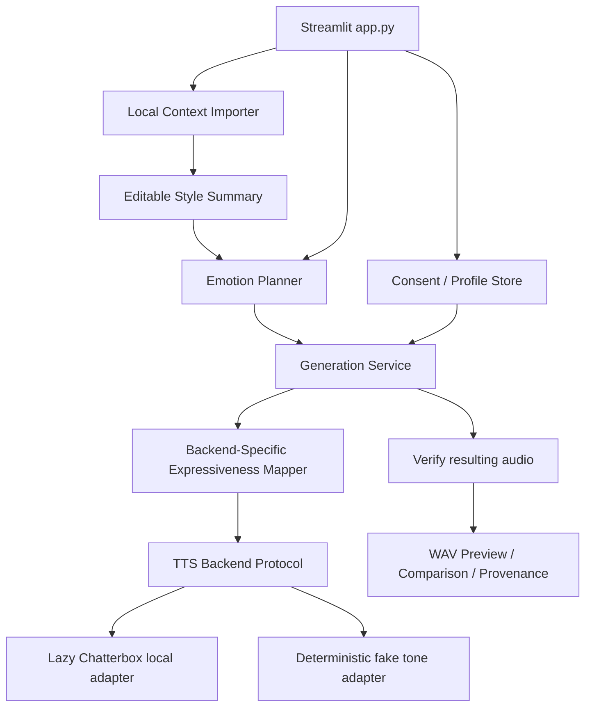

# Architecture



`config.py` reads env defaults; `models.py` defines typed records. `audio/validation.py` decodes/validates and produces PCM16 mono 24 kHz user references. `storage/local_store.py` isolates random folder IDs, validates references, saves JSON atomically, and implements deletion. `services/context.py` parses bounded context and produces a deterministic, low-confidence summary; `services/emotion.py` chooses a delivery label from user text and optionally an approved fallback preference. A user override always wins. `services/generation.py` resolves authorized references, validates requests and output, and formats synthesis metadata. The backend's `synthesize()` method sees only typed text, reference WAV path, language and documented numeric controls.

### Trust and processing boundary

- Consent gate is before disk persistence; it is **not** legal proof of voice ownership.
- All user audio paths resolve inside the local storage root; unrecognized IDs and symlink escapes are rejected.
- Input audio is decoded through libsndfile; it is not executed.
- No cloud inference or chat history scraper is implemented.
- Model weights are lazily initialized on a button action, not the home page; there is no automatic silent fallback from live to demo.
- WAV export is synthesized audio accompanied by human-readable disclosure and optional metadata JSON. The model's source watermark is not intentionally removed.
- The fake backend exists for **tests** and an explicitly requested test runtime; it never represents human speech.

### Version 1 storage

```
data/profiles/<random-id>/profile.json
                          references/neutral.wav
                          references/<delivery>.wav
```

No database server and no saved generated WAV files. Streamlit session state temporarily holds a maximum of two output variants plus editable context input and ratings. Multi-user public access requires a distinct authentication and storage-security design and is not supported.
