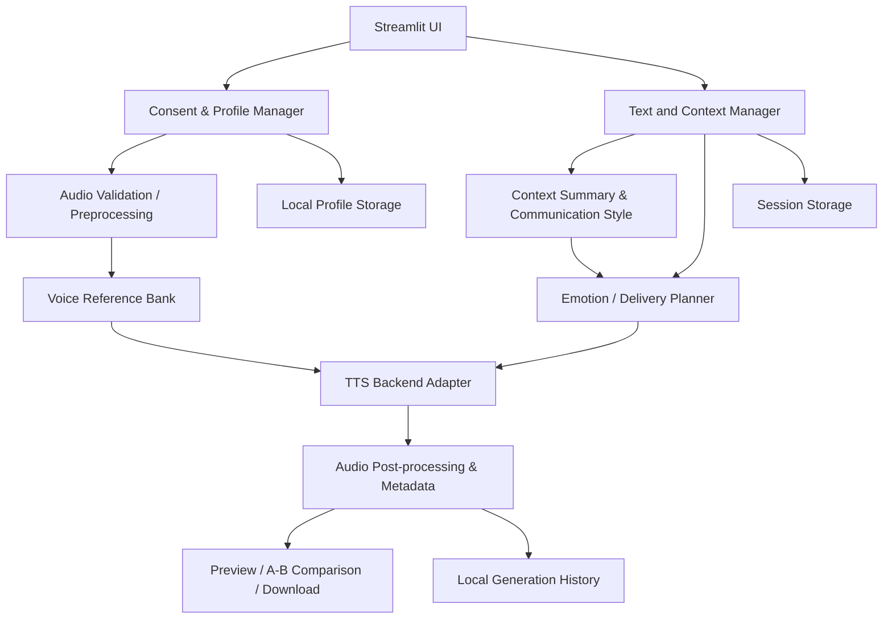

# instructions.md — Context-Aware Affective Speech Synthesis

> **Working product name:** EchoPersona (rename only if a better name is chosen consistently throughout the project)  
> **Project title:** Context-Aware Affective Speech Synthesis: Generating Emotionally Resonant Personalized Voice Clones from Conversational History  
> **Project type:** Demonstration-first applied AI project with a research/evaluation layer  
> **Primary output:** A runnable, polished local web application and a ZIP archive containing the complete source code and documentation.

---

## 0. Instructions to the coding LLM

You are the lead software architect, ML engineer, product designer, QA engineer, and technical writer for this project. Implement a complete, useful, demonstrable application—not merely a proposal, notebook, mock-up, or research report.

Follow these rules throughout implementation:

1. **Build a working product before optional research features.** The user must be able to open the app, create a consented voice profile, enter text, choose or review an emotion, synthesize audio, listen to it, and download it.
2. **Do not claim capabilities that the selected model does not support.** In particular, do not claim that an emotion label, speaking-rate target, or conversational style is faithfully controlled unless the backend actually supports it and tests or user-facing evidence validate the claim. Use careful language such as “suggested delivery” and “best-effort emotional conditioning.”
3. **Use a modular backend adapter.** Model-specific logic must not be scattered through the UI. A future voice engine should be replaceable without rewriting the application.
4. **Make the basic application useful without a paid API key.** The default live synthesis engine should be local/open-weight where feasible. Cloud LLM features must be optional and disabled by default. Clearly disclose any data sent to a third-party service.
5. **Do not train or fine-tune a TTS model for the MVP.** Use supported inference APIs and reference conditioning. Training would make the first version slower, more expensive, and harder to reproduce.
6. **Do not use someone’s voice without explicit permission.** The recommended first release is for the user’s own voice. Use generic or fully consented demo recordings for demonstrations. Do not fetch celebrity, public-figure, friend, family, or other third-party voice clips from the internet.
7. **No deception features.** Do not add caller-ID spoofing, real-time impersonation, hidden voice cloning, fake consent, bypasses for model safeguards, or functionality designed to make generated speech pass as a real recording. Prominently identify generated audio as AI-generated.
8. **Do not require a large language model for the entire app to function.** Context summarization and emotion detection need reliable local baselines. A cloud LLM may be an optional enhancement, not a mandatory dependency.
9. **Keep personal audio and conversation histories local by default.** Do not log transcript contents, save uploaded files to temporary directories indefinitely, or send them to telemetry services.
10. **Actually run the available checks.** Include unit tests, integration tests that do not need model weights, and smoke tests. Report what was tested and what could not be tested because of missing hardware/model downloads. Never say tests passed if they were not run.
11. **Use explicit dependency/version management.** Inspect the currently documented official APIs of the selected TTS backend before coding. Pin compatible dependency ranges or exact tested versions in a lock file. Do not silently rely on undocumented arguments.
12. **Produce the complete artifact.** Create the project directory, all source/config/docs/tests, a `README.md`, an `.env.example`, and a ZIP such as `EchoPersona_Project.zip`. Do not stop after printing code snippets. The ZIP must contain the source tree but exclude virtual environments, model weight files, caches, user recordings, secrets, generated personal speech, and temporary files.
13. **When a requirement conflicts with feasibility, implement the simplest honest working fallback and document it.** Do not leave dead buttons or pretend features. Every button must work or be visibly disabled with an explanation.
14. **Prefer a simple stack.** Use Python and Streamlit for the interface. Avoid React/Next.js and avoid introducing a database server, task queue, containers, or microservices unless a real requirement emerges.

At the end, deliver:

- `EchoPersona_Project.zip`
- the unpacked project folder if the environment supports it
- a concise implementation summary
- exact setup/run commands for Windows PowerShell and macOS/Linux
- a testing report that distinguishes automated tests, manual smoke tests, and unverified model-dependent behavior
- a list of limitations and a clear next-steps roadmap

---

## 1. Product vision and the problem we are solving

### 1.1 Product vision

Build a **personalized expressive text-to-speech assistant** that can speak text in a voice profile made from recordings the user is authorized to use. It uses user-provided conversational context to understand a preferred communication style and to suggest a suitable delivery style for each message. The user remains in control: they can inspect, change, or reject the suggested emotion before generating speech.

The experience should feel like a small, practical tool—not a laboratory notebook. It should help a person turn text into speech that feels more like their own manner of speaking and carries the intended tone.

### 1.2 Who can benefit

Prioritize these non-clinical use cases:

- **Accessibility and communication support:** a person who prefers typing or has temporary or ongoing difficulty speaking can prepare spoken messages in a familiar, personally meaningful voice.
- **Voice preservation experimentation:** a user can explore how a personal voice profile might sound when reading new text. This is a prototype, not a medically validated long-term voice-banking service.
- **Personalized audio messages:** users can generate conversational messages with calmer, warmer, excited, reassuring, or neutral delivery instead of a single flat synthetic style.
- **Communication assistance:** a user can compare a neutral version with a context-aware version before sharing it.

Do not claim that the application diagnoses emotion, understands a person’s true inner state, replaces speech-language pathology, or is suitable for emergency/clinical communication without further validation.

### 1.3 The key product insight

“Emotionally resonant” requires more than classifying a sentence as happy or sad. A useful demo should combine:

1. **Speaker identity:** a reference recording (or collection of recordings) from the consenting speaker.
2. **Context:** a small, user-visible summary of the conversation style or prior messages that the user deliberately imports.
3. **Affective intent:** the emotional tone the current text is intended to convey.
4. **User control:** a transparent suggestion with editable emotion and intensity.
5. **Backend-aware conditioning:** use only controls the installed TTS engine actually supports—for example, a selected speaker reference clip, documented expressiveness parameters, or natural-language delivery instructions on a compatible backend.
6. **A/B comparison:** let the user hear a neutral baseline and a context-aware rendering of the same text.

The system must not imply that it can reliably infer a user’s real emotional state. It estimates the *intended delivery of the text* and should ask the user to correct the estimate.

### 1.4 Proposed project name and product description

Use **EchoPersona** as a working name. The short product description should be:

> “A privacy-conscious expressive TTS demo that turns text into speech using a voice profile you are authorized to use. It learns lightweight communication preferences from context you choose to provide, suggests a delivery style, and lets you review the result before using it.”

Do not use a logo or visual identity that suggests a medical device, an official identity-verification product, or a real human recording service.

---

## 2. Scope: what the first version must and must not do

### 2.1 Mandatory MVP features

The first complete version must include:

- A polished Streamlit multi-page/single-page app with clear navigation.
- A first-run safety and privacy notice.
- A consent-confirmation flow before creating a voice profile.
- Upload and validation of a speaker reference recording.
- Optional emotion-labelled reference clips recorded by the same consenting speaker.
- A voice profile summary page with sample metadata and an explicit delete-profile action.
- Text input for speech generation.
- Import of user-provided conversation history from `.txt` and `.json` files, plus a manual paste option.
- A local context processor that extracts simple communication preferences without requiring an external LLM.
- Suggested delivery/emotion, confidence/uncertainty, and a manual override.
- A backend adapter interface and at least one implemented local TTS backend.
- A neutral-vs-conditioned generation workflow when the backend is available.
- Audio playback, audio download, generation metadata, and a visible AI-generated disclosure.
- Loading/progress feedback and friendly errors for missing model weights, unsupported hardware, invalid audio, and inference failures.
- A demo mode that allows reviewers to explore the interface when model weights or a compatible GPU are unavailable. Demo mode must use clearly labelled pre-generated, licensed/consented assets or a transparent mock generator; it must never pretend mock audio was generated by the live model.
- Unit tests and model-independent integration tests.
- Setup and troubleshooting instructions for Windows, macOS, and Linux.
- A ZIP file of the complete source project.

### 2.2 Useful second-stage features (implement only after the MVP passes)

- An optional local emotion classifier using a small, documented model.
- An optional user-opted-in cloud LLM for summarizing conversational context.
- Optional speech transcription of reference audio to help the user enter the reference transcript; always allow manual correction.
- Multiple saved user-owned profiles, still local-only and protected by explicit controls.
- A compact comparison panel for synthesis settings and generation latency.
- A basic evaluation page with user ratings and objective metadata.

### 2.3 Explicit non-goals for version 1

Do not implement:

- Training/fine-tuning a foundation TTS model.
- A full production SaaS platform, accounts, billing, or a public voice marketplace.
- Public sharing of voice profiles.
- Voice transfer from arbitrary uploaded audio without authorization.
- Deepfake detection or identity verification claims.
- Automated messaging, phone calls, or real-time voice agents.
- Psychological profiling or permanent inference about a user’s emotional health.
- A claim of exact voice reproduction or guaranteed emotion fidelity.
- A React/Next.js frontend or a complex cloud architecture.

---

## 3. Model strategy and technical honesty

### 3.1 Primary local engine: Chatterbox TTS

Use the official [Resemble AI Chatterbox repository](https://github.com/resemble-ai/chatterbox) as the **first backend to evaluate and integrate**. Its published interface supports reference-audio voice conditioning and an expressiveness/exaggeration control. The repository also documents an embedded PerTh watermark for generated audio. The implementation must check the latest official repository/API and licensing before locking dependencies.

Important caveat: Chatterbox’s `exaggeration` parameter is not a universal “set emotion to sadness/happiness” control. Do not map a categorical emotion to a parameter and then claim that the model perfectly renders that emotion. For the MVP:

- Select an emotion-labelled reference clip from the user’s own voice bank when one is available.
- Use documented expressiveness parameters within the range demonstrated by the installed backend.
- Keep a user-facing intensity slider so the user can adjust the result.
- Describe emotion conditioning as **best-effort** and let the user preview the output.
- Keep the original text unchanged by default. Any text normalization must be conservative and visible to the user.
- Preserve model watermarks and other provenance features; do not add a feature to remove them.

Official starting points:

- Chatterbox repository/API: <https://github.com/resemble-ai/chatterbox>
- Chatterbox documentation describes reference-audio use and expressiveness tuning. Confirm exact arguments against the currently installed version.

The main application should import the backend lazily. Streamlit’s first page load should not force a several-gigabyte model download. On first live synthesis, show the model name, expected download/hardware requirements, and a clear start action.

### 3.2 Optional research/upgrade engine: Qwen3-TTS

Design the adapter so an optional Qwen3-TTS backend can be added or substituted after the MVP works. The official [QwenLM/Qwen3-TTS repository](https://github.com/QwenLM/Qwen3-TTS) describes 0.6B and 1.7B variants, voice cloning through reference audio and transcript, and separate VoiceDesign/CustomVoice models with natural-language instruction control. Its published documentation distinguishes the capabilities of the Base and VoiceDesign/CustomVoice models. Do not assume that a Base voice-cloning model accepts every instruction supported by a different model in the family.

The Qwen3-TTS technical report states that the released models/tokenizers are under Apache 2.0; still inspect the exact model card and license of the specific checkpoint used before redistribution or commercial use. Model size and speed depend on the selected checkpoint and hardware.

Official starting points:

- <https://github.com/QwenLM/Qwen3-TTS>
- <https://huggingface.co/Qwen/Qwen3-TTS-12Hz-1.7B-Base>
- Technical report: <https://arxiv.org/abs/2601.15621>

If implementing this optional backend, expose only the controls its exact method supports. If an emotion instruction cannot be passed through the chosen clone model, condition with the speaker’s emotion-matched reference recording and state that limitation. Never invent unsupported method arguments.

### 3.3 License policy

Before using any model, code package, checkpoint, audio example, or voice sample:

1. Check the source repository license.
2. Check the model-weight license separately from the code license.
3. Check the license/consent for each voice/sample asset separately.
4. Include a `THIRD_PARTY_NOTICES.md` listing name, source URL, version/checkpoint, license, use in project, and restrictions.
5. Do not include large model weights in the ZIP unless redistribution is clearly permitted and the user explicitly requests it. Normally keep weights outside the repo and download them at runtime with a documented command.
6. Never include private or unlicensed reference audio in the source archive.

Do not choose Coqui XTTS-v2 or F5-TTS as the default without examining the current model license. Their published model terms have included non-commercial restrictions. Do not rely on a repository’s code license as proof that its model weights are permissively licensed.

### 3.4 Runtime modes

Implement three explicit runtime modes:

- **`live_local`:** load the configured local TTS model and synthesize real output.
- **`demo`:** show the UI and, where available, play pre-generated sample files that are clearly marked “Demo sample—not generated from your voice.” If no suitable lawful sample exists, use a mock status/output record and keep audio playback disabled rather than generating fake audio.
- **`test`:** use a deterministic fake backend that returns test metadata and a short generated test tone only if the test explicitly requests that fixture. Never display this as human speech.

The mode must appear in the UI and in the generation record. Do not quietly fall back from `live_local` to `demo` after a model error; display the error and let the user deliberately switch modes.

---

## 4. High-level architecture

Use a modular, monolithic Python application. Separate presentation, domain logic, audio processing, context handling, and model integration.



### 4.1 Layers and responsibilities

**Presentation layer**
- Streamlit pages/components.
- Form state and validation messages.
- Preview player, sliders, profile details, and download controls.
- No model inference implementation inside page files.

**Domain layer**
- Pydantic/dataclass types for voice profiles, context summaries, emotion plans, generation requests, and generation results.
- Business rules for consent, supported emotions, text length, file size, and profile deletion.
- No direct calls to Streamlit.

**Audio layer**
- Read audio safely, validate duration/format/sample-rate/channel count, resample if required, convert to mono only when appropriate, and write temporary normalized WAV files.
- Feature extraction such as speech rate or silence ratio is best-effort, optional, and labeled approximate.
- Never store or output raw audio features as medical/psychological interpretations.

**Context layer**
- Parse user-provided `.txt`/`.json` conversation exports.
- Produce a concise, transparent style profile: common language, average sentence length, punctuation tendency, approximate formality, and preferred tone if explicitly supplied.
- Remove control characters, limit input size, and avoid parsing arbitrary scripts as executable content.
- Store no imported history beyond the current session unless the user deliberately saves a compact profile summary.

**Affective planning layer**
- Suggest the intended delivery for the current text from the text and optional nearby context.
- Return a structured `EmotionPlan` with label, intensity, confidence, explanation, candidate reference clip, and backend-supported controls.
- Always allow manual override.
- Treat uncertainty as expected. Do not tell the user what they “really feel.”

**TTS adapter layer**
- Defines one protocol/interface.
- Provides a Chatterbox implementation and deterministic fake/test implementation.
- Optionally supports Qwen3-TTS later.
- Knows about model-specific options, model loading, device choice, output sample rate, and cleanup.

**Persistence layer**
- Local folders and JSON metadata for the initial demo; no database server required.
- Separate durable user-owned profile data from temporary session data.
- Provide a reliable deletion function that removes profile assets and metadata.
- No remote telemetry by default.

### 4.2 Suggested data flow for one generation

1. The user types or pastes text.
2. The context processor adds only the conversation summary the user elected to use.
3. The affective planner suggests a delivery label and confidence, showing a short reason such as “The text contains reassurance language.”
4. The user accepts or overrides the delivery and adjusts intensity.
5. The planner picks a matching emotion-labelled speaker reference clip when available. If only a neutral clip exists, it uses that clip and explains that emotion control may be limited.
6. The adapter converts the request to controls supported by its backend.
7. The TTS backend generates audio.
8. Post-processing validates duration, sample rate, amplitude, and empty/corrupt output.
9. The app presents playback and an optional neutral-vs-conditioned comparison.
10. The user downloads the file with clear provenance metadata and can delete the generation history.

---

## 5. User journeys and application pages

Build the app around a clear top-level navigation. A Streamlit sidebar is sufficient. Do not overbuild the front end.

### Page 1 — Home / Start Here

Include:

- Product title and one-sentence purpose.
- Three-step explanation: “Create your voice profile → add context → generate expressive speech.”
- Status chips/text for runtime mode, TTS model status, model download status, and hardware.
- A visible disclaimer that generated audio is synthetic and may not preserve identity or emotion perfectly.
- A short privacy statement: “Your profile and imported history stay on this device by default.” This statement must match the actual code—do not make it if data is transmitted.
- Buttons: `Create voice profile`, `Open speech studio`, `Try demo mode`.

### Page 2 — Voice Profile Setup

Flow:

1. Display the consent notice before showing the upload component.
2. Require the user to confirm one of these choices: “This is my own voice” or “I have explicit permission from the adult speaker to create and use this voice profile.” Keep the demo recommended for the user’s own voice. Do not permit a profile to be saved without confirmation.
3. Require a second intentional action: typed confirmation such as `I HAVE PERMISSION TO USE THIS VOICE`. Do not claim this proves identity; it is a user acknowledgement and friction against accidental use.
4. Upload a WAV/MP3/M4A/FLAC/OGG/WebM recording, subject to the installed audio parser’s true support. Limit file size and maximum duration; for the initial reference use approximately 5–30 seconds of clean speech. Treat model-specific recommendations as configurable rather than universal.
5. Preview the audio before saving it.
6. Show validation feedback: duration, channels, sample rate, clipping/silence estimates, and whether speech appears to be present. These are technical checks, not proof that the recorded speaker consented.
7. Ask the user to enter/correct the exact reference transcript if required by the backend.
8. Save the normalized reference audio and profile metadata only after the user presses `Save profile`.
9. Explain that voice similarity and emotional transfer vary with recording quality and model behavior.

Optional **emotion reference bank**:
- Allow the user to add one or more clips from the same speaker and label each manually: `neutral`, `calm`, `happy`, `sad`, `concerned`, `reassuring`, or `excited`.
- Include a short, consistent script suggestion to make recordings easier to compare.
- Let the user preview, relabel, replace, and delete each clip.
- Never infer a definitive emotion label from acoustic signals alone. If automatic suggestions are added, make them optional and editable.
- If a clip is missing for a chosen delivery, fall back to the main reference clip and show a notice.

### Page 3 — Conversation Context

Allow:
- Paste conversation text.
- Upload a `.txt` file.
- Upload a documented `.json` schema, for example a list of objects with `role` and `content`, or a list of messages. Reject unrecognized structures with an example, not a traceback.
- Review extracted context before using it.
- Edit or clear the generated summary.
- Choose whether context is used for the current session only or whether a compact summary is saved to the local profile.

The summary should focus on **communication style**, not sensitive personality profiling. Good fields include:

- Preferred language.
- Typical sentence length (rough estimate).
- Formal vs casual tendency (low-confidence heuristic).
- Common greeting/sign-off patterns.
- Explicitly user-selected preferred tone (e.g. direct, warm, calm).
- Optional phrases the user wants preserved.

Never derive or store sensitive attributes, mental-health diagnoses, religious beliefs, political views, or other sensitive traits. Do not silently persist full conversation text. Present the summary as editable observations, not facts about identity.

### Page 4 — Speech Studio (main product)

This is the primary demo surface. It should feel finished, clean, and easy to explain during a presentation.

Inputs:

- Text area: message to speak.
- Character/word count and a sensible maximum length for the first version.
- Toggle: `Use my saved context summary`.
- Suggested delivery label with a confidence/uncertainty note.
- User-selectable delivery: `Neutral`, `Calm`, `Warm/Reassuring`, `Happy`, `Sad/Reflective`, `Concerned`, `Excited`.
- Intensity slider: low to high. Translate to backend parameters only through a documented mapping function.
- Optional speaking style description (short text) only if the backend supports instruction control. If it does not, explain that this text is currently descriptive and does not control the model; do not expose a nonfunctional control.
- `Generate neutral`, `Generate context-aware`, and `Compare both` controls. Buttons must be disabled with a helpful reason if no valid profile or backend is configured.

Output:

- Audio player.
- Download `.wav` button; `.mp3` is optional and should only be included if a reliable encoder is available.
- Model/engine label and runtime mode.
- The selected emotion/reference clip and actual backend parameters used, presented in a “Generation details” expander.
- Generation time, audio duration, and output sample rate.
- A visible caption: “AI-generated speech. This audio is synthetic; review before sharing.”
- A short rating control: “Did this delivery match your intention?” with optional `Too flat`, `Good`, `Too expressive`, `Wrong tone`, `Other` response. Keep this feedback local; it may support evaluation but must not automatically train a model.

Never auto-share or auto-send generated audio. The user must take an explicit download/share action.

### Page 5 — Compare and Evaluate

Show a side-by-side A/B view when both generations exist:

- A: neutral baseline.
- B: context-aware rendering.
- Identical text, clearly displayed.
- Play buttons for both recordings.
- User ratings for naturalness, speaker similarity, intended emotion, and intelligibility on a 1–5 scale.
- Clearly distinguish subjective ratings from objective measurements.
- Do not show fabricated benchmark scores. Any aggregate chart must use actual ratings or test results from the current dataset.

### Page 6 — Privacy and Data Controls

Include:

- What is stored, where it is stored, and whether any remote service is active.
- Current profiles and their files.
- `Delete voice profile` with a deliberate confirmation step.
- `Clear imported context`.
- `Clear session generations`.
- `Delete all local project data` with a clear warning and confirmation.
- Data-retention behavior and paths.
- Reminder not to upload someone else’s voice or private conversations without permission.

Deletion must remove the corresponding files and metadata; it must not be an inert UI action.

---

## 6. Emotion and context design

### 6.1 Separate three concepts

The implementation must not collapse these ideas into one variable:

1. **Text sentiment:** positive/negative/neutral valence or lexical signals.
2. **Intended delivery:** the tone the speaker wants to convey, e.g. reassuring, excited, reflective, neutral.
3. **Speaker identity/style:** the voice traits carried by the speaker reference and any user-defined preferences.

They are related but not interchangeable. A negative sentence may be spoken calmly, and an upbeat sentence may be delivered sarcastically. The user’s override must always take precedence over the inferred delivery.

### 6.2 MVP emotion planner

Implement `EmotionPlanner` as a deterministic, testable module. Use lightweight heuristics for the MVP rather than making a cloud model mandatory.

Inputs:

- current text;
- optional recent context excerpt or saved style summary;
- selected language;
- user-selected default delivery;
- optional user-provided intent phrase.

Output model, for example:

```python
class EmotionPlan(BaseModel):
    label: Literal[
        "neutral", "calm", "warm_reassuring", "happy",
        "sad_reflective", "concerned", "excited"
    ]
    intensity: float  # normalized 0.0 to 1.0
    confidence: float  # 0.0 to 1.0; heuristic confidence, not a calibrated probability
    explanation: str
    reference_clip_id: str | None
    backend_controls: dict[str, object]
    warnings: list[str]
    requires_user_confirmation: bool
```

Use a calibrated-sounding but honest label such as “heuristic confidence.” Do not display a percentage if the rule-based system cannot justify calibration; an indicator like `Low / Medium / High confidence` may be safer.

The planner should:

- detect obvious linguistic cues with small, documented rule sets;
- use the context summary only when the user enabled it;
- avoid overriding an explicit user selection;
- return `neutral` or `uncertain` when cues conflict;
- provide a short reason;
- expose its result to the UI for editing;
- never interpret the result as a diagnosis or certain internal emotional state.

If an optional ML emotion classifier is added, it must be behind a configuration flag and adapter. Document its checkpoint, license, supported languages, and known biases. It must not send text to the cloud without opt-in.

### 6.3 Context summarization without an external LLM

For the default local summary, implement modest heuristics:

- split text into sentences;
- compute rough sentence and message lengths;
- count greeting, politeness, punctuation, and commonly repeated phrases from safe lists;
- infer a low-confidence formal/casual indicator;
- keep a list of explicit user preferences separate from heuristic observations.

Do not implement open-ended psychological inference. Avoid sentiment over many private conversations becoming a permanent “personality profile.”

Optional cloud summary:
- Off by default.
- Separate opt-in toggle shown immediately before use.
- Display exactly what text/context would be transmitted.
- Send the minimum necessary context.
- Do not store the API key in code or profile files.
- Do not silently switch to cloud mode when a local method fails.

### 6.4 Affective conditioning adapter

Create a `ConditioningPlan` that maps the desired delivery to **supported controls** in the active TTS engine. The plan may include:

- reference clip path and its user-assigned label;
- documented emotion/style instruction if the backend supports it;
- documented intensity/exaggeration setting if supported;
- supported speed controls if supported;
- whether a fallback was applied;
- a user-readable limitation message.

The mapping must live in backend-specific code, not in Streamlit widgets. Example design:

- If the user chooses `happy` and a `happy` reference is present, select it.
- If no `happy` reference exists, select the neutral clip and explain the fallback.
- If Chatterbox is used, map intensity to its documented expressiveness parameter using a configurable range based on the installed version; do not call it “happiness strength.”
- If a future backend supports natural-language emotion instructions for cloned voices, pass the instruction through that backend’s documented API and test it separately.

Treat reference-prosody transfer as experimental. An emotion-labelled reference is a cue—not a guarantee that the output will preserve the same emotion. Keep preview and A/B comparison central to the UX.

### 6.5 Acoustic profile features

Optionally extract simple features from the user’s reference audio:

- duration;
- approximate speech rate when transcript/word count is available;
- silence ratio;
- loudness/RMS summary;
- approximate pitch median/range only if a reliable method is installed and voiced segments are detected correctly.

These are descriptive diagnostics. Do not imply the Chatterbox engine can directly reproduce every measured feature. Do not add medical/biometric identification claims. If pitch extraction fails, mark it unavailable rather than inventing a value.

---

## 7. Technical stack

Use the following unless a verified compatibility issue requires a small change:

- **Python:** a version supported by the pinned TTS stack. Check the official model repository first; create a fresh environment. Do not force a newest Python version if the backend does not support it.
- **UI:** Streamlit.
- **Data validation:** Pydantic or typed dataclasses; prefer Pydantic for files/config payloads where validation helps.
- **Audio arrays/files:** NumPy, SoundFile, and the utilities required by the selected model. Use `librosa` only where a necessary feature is not practical otherwise.
- **Configuration:** environment variables plus a typed settings module; use `.env.example` and `.gitignore`.
- **Testing:** pytest.
- **Logging:** Python `logging`, configured to omit transcript text, audio contents, keys, and personal profile paths from normal logs.
- **Lint/type checks:** Ruff and mypy/pyright are optional but recommended if they do not prevent reproducible installation.
- **Charts:** Plotly only if real evaluation metrics are presented; not required for the core UI.

Do not add a heavyweight database, Redis, Celery, FastAPI, Docker, or frontend framework in version 1. A local Streamlit app and local directory storage are enough. A Dockerfile is optional, not mandatory, because model/GPU installation can be hardware-specific.

### 7.1 Configuration

Create a settings module reading environment variables such as:

```env
APP_NAME=EchoPersona
APP_MODE=demo
DATA_DIR=./data
TTS_BACKEND=chatterbox
TTS_DEVICE=auto
MAX_UPLOAD_MB=25
MAX_REFERENCE_SECONDS=30
MAX_TEXT_CHARS=1500
SAVE_GENERATION_HISTORY=false
ALLOW_CLOUD_LLM=false
LOG_LEVEL=INFO
```

Defaults must be safe. `APP_MODE` must not silently activate a cloud model. If a cloud feature is implemented, store only its API key in an environment variable or local secret manager, never in the repository. Provide `.env.example` with placeholders only.

### 7.2 Storage plan

Example local structure:

```text
DATA_DIR/
  profiles/
    <random_profile_id>/
      profile.json
      references/
        neutral.wav
        calm.wav
        happy.wav
      generations/                 # only if explicitly enabled
        <random_generation_id>.wav
  sessions/                        # temporary or session-scoped artifacts
  cache/                            # optional, non-sensitive computation cache
```

Requirements:

- Use random IDs rather than names in folder paths.
- Use safe path resolution; reject path traversal and symlink tricks where practical.
- Store profile metadata atomically via temporary file + rename.
- Avoid embedding full transcripts or conversation histories in `profile.json`.
- Set `SAVE_GENERATION_HISTORY=false` by default.
- On deletion, remove files and profile metadata; return a clear success/failure result.
- The README must explain that deleting files from the app is not a certified forensic wipe from SSDs, backups, OS caches, or external copies.
- Never put `DATA_DIR` under the zipped repository unless using clearly synthetic fixtures.

---

## 8. Required repository layout

Generate a maintainable structure close to this. You may adjust minor file names if every responsibility remains separated.

```text
EchoPersona/
├── app.py
├── pages/
│   ├── 1_Voice_Profile.py
│   ├── 2_Conversation_Context.py
│   ├── 3_Speech_Studio.py
│   ├── 4_Compare_Evaluate.py
│   └── 5_Privacy_Data.py
├── src/
│   └── echopersona/
│       ├── __init__.py
│       ├── config.py
│       ├── logging_config.py
│       ├── domain/
│       │   ├── models.py
│       │   ├── errors.py
│       │   └── enums.py
│       ├── services/
│       │   ├── profile_service.py
│       │   ├── consent_service.py
│       │   ├── context_service.py
│       │   ├── emotion_planner.py
│       │   ├── generation_service.py
│       │   ├── evaluation_service.py
│       │   └── deletion_service.py
│       ├── audio/
│       │   ├── validation.py
│       │   ├── preprocessing.py
│       │   ├── features.py
│       │   └── export.py
│       ├── backends/
│       │   ├── base.py
│       │   ├── chatterbox_backend.py
│       │   ├── fake_backend.py
│       │   └── registry.py
│       ├── storage/
│       │   ├── local_store.py
│       │   └── paths.py
│       └── ui/
│           ├── components.py
│           └── state.py
├── tests/
│   ├── unit/
│   │   ├── test_audio_validation.py
│   │   ├── test_context_service.py
│   │   ├── test_emotion_planner.py
│   │   ├── test_profile_service.py
│   │   ├── test_paths_and_deletion.py
│   │   └── test_generation_service.py
│   ├── integration/
│   │   ├── test_fake_backend_flow.py
│   │   └── test_storage_roundtrip.py
│   └── fixtures/
│       └── README.md
├── scripts/
│   ├── check_environment.py
│   └── create_demo_fixtures.py
├── docs/
│   ├── ARCHITECTURE.md
│   ├── MODEL_NOTES.md
│   ├── PRIVACY_AND_SAFETY.md
│   ├── EVALUATION_PROTOCOL.md
│   └── TROUBLESHOOTING.md
├── data/                           # ignored, created on first run
│   └── .gitkeep
├── .streamlit/
│   └── config.toml
├── .env.example
├── .gitignore
├── pyproject.toml                  # or requirements files; choose a reproducible approach
├── requirements.txt                # if needed for simple setup
├── requirements-dev.txt
├── README.md
├── THIRD_PARTY_NOTICES.md
├── LICENSE                         # only if ownership/license choice is clear
└── instructions.md                 # this specification may be copied into project docs
```

Do not create empty files merely to match the tree. Every included module should be implemented, or the tree and README should clearly label a planned extension. Avoid circular imports. Use absolute package imports from `echopersona`.

---

## 9. Domain models and interfaces

Design models with explicit validation and stable serialization. At minimum implement equivalents of these types:

### 9.1 VoiceProfile

Fields:

- `profile_id: str` — random identifier.
- `display_name: str` — optional user-chosen label; never used as a filesystem path.
- `created_at: datetime`.
- `consent_confirmed: bool`.
- `consent_scope: Literal["own_voice", "authorized_adult_voice"]`.
- `consent_notice_version: str`.
- `primary_reference_path: str` — relative to the profile directory.
- `primary_reference_transcript: str | None`.
- `emotion_references: dict[EmotionLabel, ReferenceClipMetadata]`.
- `communication_preferences: dict[str, object]` — only fields the user saved or approved.
- `summary_version: int`.

Do not store the actual uploaded binary audio inside JSON. The app may show a display name but should not include personally identifying data in logs.

### 9.2 ReferenceClipMetadata

Fields:

- `clip_id`;
- `relative_path`;
- `label`;
- `transcript` if required;
- `duration_seconds`;
- `sample_rate_hz`;
- `created_at`;
- `user_labelled: bool`;
- `processing_warnings: list[str]`.

### 9.3 ContextSummary

Fields:

- `summary_id`;
- `created_at`;
- `source_kind` (`manual`, `txt_upload`, `json_upload`);
- `user_approved: bool`;
- `preferences`;
- `heuristic_observations`;
- `warnings`;
- optional source digest, but do not retain full original source content by default.

### 9.4 GenerationRequest

Fields:

- `text`;
- `profile_id`;
- `language`;
- `requested_delivery`;
- `intensity` in `[0, 1]`;
- `use_context`;
- optional `context_summary_id`;
- `compare_with_neutral`;
- `runtime_mode`;
- backend-specific options only through a validated dictionary/typed submodel.

Validate length and reject empty/whitespace-only text. Never evaluate user text as code or as a shell command.

### 9.5 GenerationResult

Fields:

- `generation_id`;
- `created_at`;
- `success`;
- `audio_path` if saved;
- `audio_bytes` or an in-memory object where safe;
- `sample_rate_hz`;
- `duration_seconds`;
- `backend_name`;
- `backend_version`;
- `runtime_mode`;
- `delivery_requested`;
- `reference_clip_used`;
- `controls_applied`;
- `warnings`;
- `elapsed_seconds`;
- `provenance_label` fixed to indicate synthetic output.

Do not persist a `GenerationResult` by default. A generation record should never include original conversation history or secret configuration.

### 9.6 TTSBackend protocol

Define an interface similar to:

```python
class TTSBackend(Protocol):
    @property
    def name(self) -> str: ...

    def health_check(self) -> BackendHealth: ...

    def load(self) -> None: ...

    def synthesize(self, request: BackendSynthesisRequest) -> BackendSynthesisResult: ...

    def unload(self) -> None: ...
```

`BackendSynthesisRequest` should contain text, reference audio path, optional reference transcript, target language, validated supported controls, and output preferences. Keep UI-specific objects out of this interface. The fake backend must implement the same protocol.

---

## 10. Audio ingestion and preprocessing

### 10.1 Validation

Implement robust checks for:

- extension/MIME mismatch where detectable;
- maximum file size;
- supported decode format;
- non-empty audio;
- minimum and maximum duration;
- sample rate and channel count;
- all-zero/silence audio;
- severe clipping/very low amplitude;
- invalid/NaN samples;
- normalization/resampling failures.

Do not trust file names or content types supplied by a browser. Never execute or import user-uploaded content. Do not accept arbitrary archives or executable files.

### 10.2 Normalization

- Use the sample rate expected by the TTS backend’s current documentation.
- Convert to mono only if the model expects mono; document that this can discard spatial information.
- Preserve the original upload only when the user chooses to save it. Otherwise create a temporary normalized copy and clean it up after the operation.
- Clip/scale cautiously; aggressive normalization can amplify noise. Keep an optional preprocessing preview.
- Avoid repeatedly resampling the same file; cache a normalized reference within the profile if the user saves the profile.

### 10.3 Transcript handling

- Let the user enter or edit the reference transcript manually.
- If speech-to-text is implemented, it must be optional, local where feasible, and editable.
- Do not require an external ASR service.
- Keep transcript text in a profile only if needed by the backend and the user saves the profile.

### 10.4 Temporary files

Use `tempfile` or a managed temporary workspace. Ensure cleanup happens in `finally` blocks. Never use a predictable shared `/tmp/output.wav` path. Do not write uploaded file content into the repository root or a publicly served directory.

---

## 11. Voice profile and local storage services

Implement service methods for:

- `create_profile(...)`;
- `add_reference_clip(...)`;
- `list_profiles()`;
- `load_profile(profile_id)`;
- `update_preferences(...)`;
- `delete_profile(profile_id)`;
- `clear_context(...)`;
- `clear_generation_history(...)`;
- `delete_all_user_data()`.

Rules:

- A missing consent confirmation must fail closed.
- Save normalized profile data atomically.
- Validate a profile folder resolves inside the configured profile root before reading or deleting files.
- Handle partial corruption gracefully; report a recoverable error, not a raw stack trace.
- Deletion must remove references, metadata, and any optional saved generations for that profile.
- Never delete arbitrary paths provided by a user.
- Add tests for nonexistent profiles, corrupted JSON, path traversal attempts, permission errors, and deletion of all files for a profile.

---

## 12. Generation service and A/B testing

Create one orchestration service for synthesis; pages call this service rather than calling the backend directly.

### 12.1 Standard flow

1. Validate request and profile consent.
2. Verify the requested engine is selected and healthy.
3. Ask the emotion planner for a delivery plan (unless user selected an explicit override).
4. Resolve the reference clip. Use user-labelled matching clip when available; otherwise use the neutral/primary reference and add a warning.
5. Convert abstract request to actual backend controls.
6. Load model lazily and synthesize.
7. Validate output and measure duration/sample rate.
8. Store in memory or temporary storage; persist only if configured.
9. Return `GenerationResult` and warnings.

### 12.2 Neutral baseline and conditioned output

`Compare both` should use the exact same text and profile. Use the same primary voice reference if the backend cannot compare a separate emotional reference fairly. When possible:

- Baseline: neutral delivery and default backend expressiveness parameters.
- Conditioned: selected reference clip and user-chosen intensity/delivery.

The comparison should communicate that outputs may differ in duration or naturalness. Do not fabricate numerical improvement scores. Let the user decide whether the delivery matches the intention.

### 12.3 Failure behavior

Handle errors for:

- backend package not installed;
- model not downloaded;
- invalid/incompatible CPU/GPU setup;
- CUDA out-of-memory;
- missing/corrupt reference audio;
- unsupported language;
- inference timeout or internal failure;
- empty output or corrupt waveform;
- model weight download failure.

Each error should yield a helpful user-facing message and a diagnostic log without transcript/audio content. Do not automatically retry indefinitely. For out-of-memory errors, suggest a smaller supported model or restart rather than pretending that reducing a slider will necessarily fix it.

---

## 13. Streamlit UI/UX requirements

Use a professional, restrained visual style: generous spacing, readable text, consistent headings, clear progress and error states, minimal decorative graphics. This is a demo application, not a marketing landing page.

### UI states

Support at least these states:

- no profile exists;
- profile saved but no backend configured;
- model is available but not loaded;
- model loading;
- generation running;
- generation complete;
- profile incomplete/invalid;
- consent not confirmed;
- context unavailable/disabled;
- demo mode active;
- deletion completed or failed.

Use `st.session_state` sparingly and do not place raw audio or full conversation history in long-lived global state. Store only the IDs needed to re-fetch data from controlled storage where practical.

### Accessibility

- All actions must have descriptive labels.
- Do not rely on color alone to communicate emotion, success, warnings, or model status.
- Make errors readable and actionable.
- Ensure audio controls and download links are easy to find.
- Avoid flashing/auto-playing audio.
- The user should initiate every playback and download.

### Demo mode

Demo mode must be a deliberate first-class path:

- It should show the complete navigation and the core workflow.
- Use a bundled sample only if its license and speaker consent are documented in `THIRD_PARTY_NOTICES.md`.
- Otherwise use a “preview workflow” with no speech audio and explain that live speech needs a compatible model/runtime. Do not use a random internet recording.
- Label synthetic samples and pre-generated files clearly.
- Tests should verify demo mode is accessible without loading model weights.

---

## 14. Privacy, consent, and misuse prevention

Safety is a product requirement, not a paragraph hidden in the README.

### 14.1 Voice consent

The default use case is a user’s own voice. Before profile creation:

- Show a plain-language consent notice.
- Require explicit acknowledgement that the user owns the recording or has permission from the adult speaker.
- Require a deliberate typed confirmation to reduce accidental cloning.
- Record that this confirmation happened, when, under which notice version, and under which declared scope.
- Do not claim the typed confirmation verifies identity or proves permission.
- Do not create profiles from a third party’s voice for a demo unless that person has explicitly agreed to the use and the source is properly documented.
- Do not support children’s voices in the MVP.

### 14.2 Provenance and transparency

- Mark every output as AI-generated in the UI.
- Add a short textual provenance note in the generation metadata and downloaded sidecar JSON when practical.
- Preserve any watermark added by the TTS backend. Never implement watermark removal.
- Do not encourage the user to state that generated audio is a genuine recording of a conversation.
- If an output is used in a public presentation, use a notice slide or caption to explain it is synthetic.

### 14.3 Conversation data

- Accept only context the user chooses to paste/upload.
- Remind the user not to include private messages from other people without permission.
- Do not auto-connect to messaging platforms or scrape chat histories.
- Do not store the raw history by default.
- Provide a user-visible review/edit step before a saved context summary is used.
- Keep cloud features disabled by default and isolate provider code behind an adapter.

### 14.4 Security

- Never hardcode API keys.
- Do not log transcript text, full file paths containing usernames, audio, or personal context.
- Validate upload sizes and formats.
- Use safe file paths and random IDs.
- Do not expose a public upload endpoint in the MVP.
- Bind the local app to localhost by default. Do not tell users it is secure for public deployment without additional authentication, HTTPS, rate limiting, data isolation, and storage controls.
- If a public demo is needed, deploy a separate demo-only instance with synthetic/consented fixture voices and no user voice uploads unless the hosting/security design has been reviewed.

### 14.5 High-risk use restrictions

Do not add or promote workflows for fraud, impersonation, misinformation, evading voice authentication, making fake evidence, or imitating a person without consent. The app should focus on accessibility and user-directed communication.

### 14.6 Disclaimer

Include this or equivalent clear wording:

> EchoPersona is an experimental demonstration of personalized expressive speech synthesis. Generated audio is synthetic and may not accurately preserve a speaker’s identity, intended emotion, or communication style. Use only voices you own or have explicit permission to use. Do not use outputs to impersonate someone, mislead listeners, or bypass identity checks. This prototype is not a medical device and is not a substitute for professional accessibility or clinical advice.

---

## 15. Logging, errors, and observability

Use structured, privacy-safe logs with fields such as:

- timestamp;
- severity;
- event type;
- backend name/version;
- runtime mode;
- elapsed time;
- success/failure category;
- error code.

Do not log raw message text, audio bytes, full transcripts, API tokens, raw conversation uploads, or sensitive profile data. Logs should help developers debug model loading and processing failures without storing user content.

Expose an app diagnostics panel with:

- Python version;
- operating system;
- selected backend;
- backend installed/available state;
- selected compute device where safely detectable;
- model loaded/not loaded;
- data directory path with sensitive username portions masked where practical;
- runtime mode.

The diagnostic screen must not reveal environment secrets.

---

## 16. Testing strategy

Testing is mandatory. The main application should be testable without downloading gigabytes of model weights.

### 16.1 Unit tests

Test at least:

- empty text and too-long text rejection;
- valid/invalid emotion labels and intensity boundaries;
- context import from a text file;
- context JSON with valid and invalid shapes;
- deterministic context-summary behavior;
- manual emotion override wins over heuristic suggestions;
- uncertain/conflicting cues do not produce a strong claim;
- reference clip selection and fallback warnings;
- Chatterbox control mapping bounds and deterministic mapping;
- unsupported controls are not passed to the backend;
- profile save/load round-trip;
- rejection of profile use without consent;
- audio size/duration/silence validation;
- safe path resolution and path traversal rejection;
- data deletion removes the correct files;
- logs do not contain raw test transcript strings.

### 16.2 Integration tests

Using the fake backend, test the whole path:

`create profile → import context → compose request → plan delivery → fake synthesize → display result metadata → delete profile`.

Use synthetic test waveforms created inside the test suite. Do not include anyone’s personal recordings in tests. Do not let integration tests load real model weights by default.

### 16.3 Live-model smoke test

Provide an opt-in command (for example `python scripts/check_environment.py --live-tts`) that loads the selected model and synthesizes one short neutral sentence from a documented consenting fixture or the user’s own local reference. Require the user to explicitly opt in before using their saved profile. The command must:

- print prerequisites and the selected model;
- avoid uploading audio remotely;
- report model load time and inference time;
- validate that the output waveform is non-empty;
- not overwrite user files;
- not log transcript or audio content;
- clearly report failure if hardware or weights are unavailable.

### 16.4 Manual acceptance test

Write a checklist in `docs/EVALUATION_PROTOCOL.md` that verifies:

1. The app opens in demo mode without model weights.
2. The consent flow blocks profile saving until acknowledgement.
3. A valid user reference recording can be previewed and saved.
4. Invalid, silent, and too-large audio gets helpful errors.
5. Text and JSON context can be loaded, reviewed, edited, and cleared.
6. Emotion suggestions can be overridden.
7. Live mode produces audio when a compatible model is installed.
8. The generated audio is playable and downloadable.
9. The app clearly discloses AI-generated audio.
10. Profile deletion removes related local data.
11. The app does not silently transmit context to a cloud service.
12. The ZIP excludes model weights, personal data, caches, logs, and secrets.

---

## 17. Evaluation: prove the demo is useful, without overclaiming

This is demonstration-first, but it still needs a modest evaluation plan. Do not present invented scores or claim scientific novelty without experiments.

### 17.1 Product questions

- Can a first-time user complete voice profile setup without assistance?
- Can the user generate a spoken message in a reasonable amount of time on supported hardware?
- Does the user prefer context-aware delivery over the neutral baseline for at least some intended messages?
- Is the delivery understandable and does it match the user’s chosen intent?
- Does the reference bank help, or does it introduce artifacts/identity drift?
- Does context improve the delivery beyond the user’s explicit emotion choice, or is manual selection already sufficient?

### 17.2 Small, responsible user evaluation

If testing with people, obtain their informed consent, explain how audio and ratings are handled, and allow them to withdraw. Use participants’ own voices or consented recordings. Do not collect more personal history than necessary.

A simple within-subject test can compare:

- A: neutral reference/default controls;
- B: manual emotion selection only;
- C: context suggestion + emotion-labelled reference/control mapping.

Use the same text and voice profile for each condition. Counterbalance order where practical. Let participants rate each output on 1–5 scales:

- intelligibility;
- naturalness;
- similarity to their own voice (self-report, not biometric proof);
- match to intended tone;
- preference overall.

Collect a short qualitative comment. Report sample size and limitations. Treat ratings as exploratory, especially with a small convenience sample.

### 17.3 Objective measurements

Capture only reproducible metrics that make sense:

- synthesis latency;
- audio duration;
- failure rate;
- output sample rate;
- user-rated clarity and delivery match.

Optional: use ASR word error rate on a fixed test set if the ASR model and test data are documented and licensed. Optional speaker-similarity/embedding metrics require special caution; do not use them as proof of identity or consent. Avoid claiming “emotion accuracy” from a generic sentiment classifier alone.

### 17.4 Required evaluation artifacts

- `docs/EVALUATION_PROTOCOL.md` describing method and limits.
- A template CSV for user ratings with no identifying columns by default.
- A script to summarize actual ratings and latency if ratings are collected.
- At least one example chart only if backed by real data. If no participants have evaluated it, include the blank template and instructions, not fake results.

---

## 18. Development workflow and milestones

Implement in vertical slices. At the end of each milestone, the project should run and tests should be green.

### Milestone 0 — Inspect, pin, and scaffold

- Inspect the current official Chatterbox documentation/API, runtime prerequisites, license, and sample generation code.
- Choose a Python version compatible with the backend.
- Create the repository layout, packaging/configuration, `.gitignore`, and `.env.example`.
- Create the backend protocol and fake backend before integrating the model.
- Add a `README.md` with honest setup sections.
- Run import/config tests.

**Gate:** the app launches in demo/test mode and pytest runs without downloading model weights.

### Milestone 1 — Consent, voice profile, and audio validation

- Implement the consent notice and explicit acknowledgement flow.
- Implement safe upload, audio validation, normalization, preview, and profile save/load.
- Implement profile list, edit preferences, add/remove emotion reference, and delete.
- Add storage path validation and deletion tests.

**Gate:** a test recording can be previewed and saved, profile metadata survives restart, and deletion works.

### Milestone 2 — Context importer and style summary

- Implement `.txt`, `.json`, and pasted-text input.
- Add schema validation, size limit, review/edit step, and clear action.
- Produce a deterministic context summary without cloud calls.
- Add tests for malformed structures, empty messages, and large inputs.

**Gate:** user can import, review, edit, and clear context without storing raw history by default.

### Milestone 3 — Emotion planner and controls

- Implement allowed delivery labels and deterministic suggestions.
- Add user override, intensity, low-confidence fallback, reference clip matching, and explanation.
- Implement backend-specific conditioning plans separately from UI.
- Test all mapping and fallback cases.

**Gate:** the app can explain and preview its plan without actually loading TTS weights.

### Milestone 4 — Local TTS adapter

- Integrate Chatterbox through the backend interface.
- Lazy-load the model and select device conservatively.
- Add model-health checks and a clear first-run loading/download screen.
- Write a live smoke-test script.
- Keep fake backend tests independent of the actual model.

**Gate:** on a supported environment, a consenting user’s reference audio can be used to generate a short WAV file; if the environment cannot run it, diagnostics show a useful explanation and the test report records the limitation.

### Milestone 5 — Speech Studio and A/B comparison

- Implement neutral, conditioned, and compare workflows.
- Add playback, WAV export, generation details, time/duration metrics, and provenance note.
- Add loading/error states and session cleanup.
- Ensure no hidden cloud fallback occurs.

**Gate:** a reviewer can perform the core demo end-to-end.

### Milestone 6 — Privacy controls, documentation, and testing

- Complete privacy page and deletion behavior.
- Review logs for content leakage.
- Write architecture/model/privacy/troubleshooting docs.
- Run unit/integration tests and all static checks.
- Run manual acceptance checklist where possible.

**Gate:** all model-independent tests pass; the live-model status is accurately reported.

### Milestone 7 — Packaging and delivery

- Verify `.gitignore` and remove real user data, model weights, caches, secrets, test output, and local logs.
- Build `EchoPersona_Project.zip` from the clean source tree.
- Test the ZIP in a clean temporary directory by following README steps as far as the environment allows.
- Provide final deliverables and an honest test report.

**Gate:** archive exists, opens correctly, and includes all necessary source/docs.

### Milestone 8 — Optional upgrades only if time remains

- Optional Qwen3-TTS adapter with its own tests.
- Optional local classifier or transcription helper.
- Optional cloud summarization with explicit opt-in.
- Optional rating aggregation dashboard.

Do not delay a functional MVP to implement these upgrades.

---

## 19. Dependency and installation policy

The TTS ecosystem can change quickly and heavy audio libraries can conflict. To make the project reproducible:

1. Inspect the currently published official installation instructions.
2. Choose a supported Python version and clean virtual environment.
3. Install only dependencies needed for the selected backend.
4. Record the tested versions in `pyproject.toml` and/or requirements files.
5. Avoid installing two conflicting TTS stacks into one environment unless the optional backend is actually implemented and tested.
6. Provide a minimal install option for `demo` mode that excludes heavy ML dependencies if practical.
7. Document any OS-specific GPU/CUDA limitations instead of trying to hide them.
8. Do not require a GPU merely to launch the app, view pages, run unit tests, or explore demo mode.
9. Do not download model weights during `pip install`. Model downloads happen only after an explicit live-model action.
10. Make `python scripts/check_environment.py` show the current mode, installed packages, device status, and exact next action.

Recommended Windows setup commands should look broadly like:

```powershell
py -3.11 -m venv .venv
.\.venv\Scripts\Activate.ps1
python -m pip install --upgrade pip
pip install -r requirements.txt
pip install -r requirements-dev.txt
streamlit run app.py
```

Replace the Python version and dependency commands if official backend requirements demand a different version. Include the actual tested commands in the generated README; do not leave “install dependencies” as a vague instruction.

macOS/Linux commands should use `python3 -m venv .venv`, `source .venv/bin/activate`, then the same pinned installs and `streamlit run app.py`.

If the actual model cannot run on a typical CPU-only laptop at acceptable speed, say so prominently. Keep the UI/test app CPU-accessible and document the supported live-inference setup. Never assert that live inference will run on all laptops.

---

## 20. Configuration, secrets, and .gitignore

Include `.env.example`, never a real `.env` file. The `.gitignore` must exclude at least:

```gitignore
.env
.env.*
!.env.example
.venv/
venv/
__pycache__/
*.py[cod]
.pytest_cache/
.mypy_cache/
.ruff_cache/
.streamlit/secrets.toml
data/profiles/**
data/sessions/**
data/cache/**
models/
checkpoints/
*.pt
*.pth
*.ckpt
*.safetensors
*.onnx
*.wav
*.mp3
*.flac
*.m4a
*.webm
logs/
*.log
.DS_Store
Thumbs.db
```

If synthetic and licensed fixture audio is bundled, store it under a clearly named `assets/demo/` directory with a per-file license/consent note and adjust ignore rules so those approved fixtures remain in the ZIP. Do not accidentally include arbitrary `.wav` files from the developer’s machine.

---

## 21. UI copy and presentation demo script

Provide a simple, repeatable 2–3 minute demo flow:

1. Start in demo mode and explain the product’s purpose and safeguards.
2. Open Voice Profile and show the consent gate. Use a consented local demo speaker or the presenter’s own voice.
3. Add a neutral reference clip and optionally a second manually labelled expressive clip.
4. Open Context and paste a short, non-sensitive sample conversation written specifically for the demo. Do not use someone’s private chat logs.
5. Review the generated communication-style summary.
6. Open Speech Studio and enter a message such as: “You have put in a lot of effort. Take a breath; we can work through this one step at a time.”
7. Compare neutral output with a calm/reassuring rendering, then manually change the delivery to neutral to show user control.
8. Play the outputs and show the details/warnings panel.
9. Download the synthetic output and point out its AI-generated disclosure.
10. Open Privacy & Data and demonstrate how to clear the imported context and remove the profile.

The demo script must not imply that one successful output proves scientific superiority or fully solves emotional speech synthesis. It demonstrates the product workflow and a promising integration.

---

## 22. README requirements

The generated `README.md` must include:

1. Project overview and product use case.
2. Feature list, with explicit `Implemented`, `Experimental`, and `Not implemented` labels.
3. Screenshot placeholders only if screenshots are not actually available; do not invent screenshots. If possible, generate real screenshots of the running UI using demo mode.
4. Model selection and limitations.
5. Exact environment setup commands for supported platforms.
6. Demo mode versus live local mode.
7. Hardware requirements and expected model-download behavior, without making unsupported performance promises.
8. How to create a profile and reference audio.
9. How to import text/JSON context.
10. How emotion planning and reference matching work, including the limitations.
11. Privacy, consent, provenance, and misuse restrictions.
12. Tests and exact commands to run them.
13. Known limitations and next steps.
14. Third-party notices and model license notes.
15. A brief acknowledgement/citation for the TTS engine.

Do not put fake experiment outcomes, fake user ratings, or “state-of-the-art” claims into the README.

---

## 23. Definition of done / acceptance criteria

The project is complete only when the following are true:

### Product
- [ ] Streamlit app launches via a documented command.
- [ ] Demo mode works without downloading large TTS weights.
- [ ] Live local backend is implemented behind an adapter, not hardcoded in UI files.
- [ ] User can create a voice profile only after the consent acknowledgement.
- [ ] Audio upload is validated and a recording can be previewed.
- [ ] Optional emotion-labelled reference clips can be saved and deleted.
- [ ] Context can be pasted/imported, reviewed, edited, and cleared.
- [ ] The affective planner suggests a delivery but lets the user override it.
- [ ] User can generate neutral and context-conditioned output when the backend is available.
- [ ] Audio playback, WAV export, generation metadata, and AI-generated disclosure work.
- [ ] Errors have useful messages; no button is silently inert.
- [ ] Deletion actions remove corresponding files.

### Engineering
- [ ] All model-independent unit and integration tests pass.
- [ ] Fake backend works with the same interface as the live backend.
- [ ] Heavy model loading is lazy and explicit.
- [ ] No credentials, private recordings, raw conversation histories, logs, or model weights are included in the ZIP.
- [ ] Logging does not contain raw text or audio.
- [ ] Backend control mappings are validated and testable.
- [ ] Documentation matches actual behavior and dependencies are pinned/reproducible.

### Honesty and safety
- [ ] Output is clearly labelled as synthetic.
- [ ] The app does not offer non-consensual cloning or impersonation workflows.
- [ ] No medical efficacy, perfect voice match, or perfect emotion recognition is claimed.
- [ ] A missing emotion reference triggers a visible fallback warning.
- [ ] Cloud processing, if available, is off by default and requires a separate opt-in.
- [ ] Model code/weights/assets have documented licenses and notices.

### Delivery
- [ ] `EchoPersona_Project.zip` exists and contains a clean source project.
- [ ] ZIP extraction succeeds.
- [ ] README setup steps have been exercised as far as the environment permits.
- [ ] Final response lists the archive path, run command, test outcomes, limitations, and next steps.

---

## 24. Final instructions to the implementing LLM

Execute the work in this order and do not skip ahead:

1. Inspect official backend installation/API/licensing information.
2. Build the project scaffold and fake backend.
3. Implement the Streamlit shell and demo mode.
4. Implement consent, audio validation, profile management, and deletion.
5. Implement context import and editable summaries.
6. Implement emotion planning and user overrides.
7. Integrate and test live local TTS.
8. Implement audio preview/download and A/B comparison.
9. Add tests, docs, and troubleshooting.
10. Run tests and report exact results.
11. Build and verify `EchoPersona_Project.zip`.

At every stage, prioritize a working, comprehensible product over adding another model or feature. If the current environment cannot install or execute the heavyweight model, still complete and test the application shell and adapter with the fake backend, document the blocker precisely, and leave a clearly specified, tested integration path. Do not silently replace real speech synthesis with mock results while claiming the project is fully live.

The final project should give a reviewer something they can genuinely run, explore, understand, and extend. It should demonstrate the full path from user-controlled context to emotion-aware synthesis while remaining clear about what the underlying model can and cannot do.

---

## 25. Official references to consult during implementation

These links are implementation starting points, not a substitute for checking the exact release/API used when coding:

- Resemble AI Chatterbox official repository: <https://github.com/resemble-ai/chatterbox>
- Qwen3-TTS official repository (optional backend/future comparison): <https://github.com/QwenLM/Qwen3-TTS>
- Qwen3-TTS technical report: <https://arxiv.org/abs/2601.15621>
- Qwen3-TTS model collection: <https://huggingface.co/collections/Qwen/qwen3-tts>
- Streamlit documentation: <https://docs.streamlit.io/>
- Pydantic documentation: <https://docs.pydantic.dev/>
- pytest documentation: <https://docs.pytest.org/>

For each dependency and checkpoint, record the version and license actually used. Do not rely solely on the information in this specification if the official model repository has changed.
